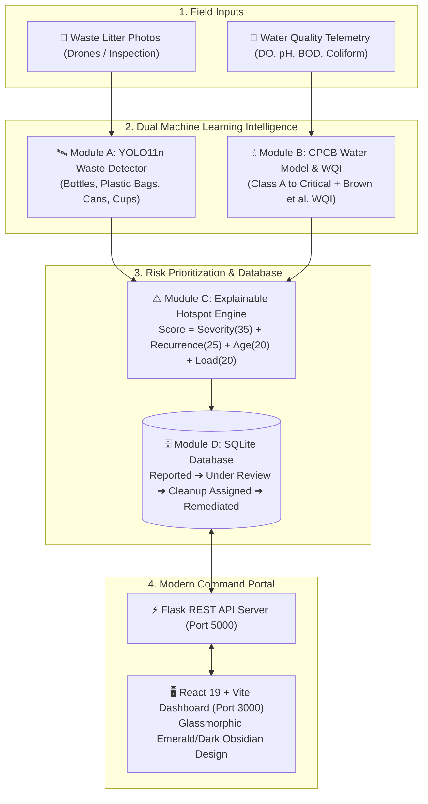

# 🌿 EcoSentinel AI — Dual-Domain Waste & Water Environmental Intelligence Grid

EcoSentinel AI is an autonomous, academic-grade Machine Learning and Environmental Risk Triage system. It fuses **YOLO11n computer vision** for visible surface litter detection and **CPCB Random Forest machine learning** for surface water quality classification, connected to an explainable **Hotspot Prioritization Engine**, an **SQLite lifecycle persistence database**, and a modern **React web dashboard**.

---

## 🏗️ System Architecture



---

## 🚀 Quickstart Guide

### 1. Requirements & Prerequisites
* **Python**: 3.10+ (Verified on Python 3.13)
* **Node.js**: 18+ (Verified on Node.js v22.16, npm 10.9)

### 2. Running the Full Stack Application

#### Step A: Start the Backend REST API Server
Open a terminal in the project root:
```powershell
python api.py
```
* Runs on: `http://localhost:5000`
* Endpoints: `/api/health`, `/api/stats`, `/api/predict/waste`, `/api/predict/water`, `/api/hotspots`, `/api/reports`

#### Step B: Start the Modern React Frontend
Open a second terminal in the `frontend` folder:
```powershell
cd frontend
npm run dev
```
* Runs on: `http://localhost:3000`
* Automatically proxies `/api` calls to the Python backend.

---

## 🧪 Running Automated Tests

Run the full test suite verifying database CRUD, lifecycle states, statutory CPCB rules, zero leakage, and domain safety guardrails:

```powershell
# Run System & SQLite Database Tests (5 tests)
python tests/test_system.py

# Run Water Intelligence & CPCB Tests (8 tests)
python tests/test_water.py
```

---

## 📊 Model Checkpoints & Performance Benchmarks

### Module A: Waste Intelligence (YOLO11n)
* **Architecture**: Ultralytics YOLO11n fine-tuned on TACO dataset (15 epochs).
* **Saved Checkpoint**: [`models/waste_yolo11n.pt`](file:///d:/EcoSentinel%20AI/models/waste_yolo11n.pt) (5.4 MB).
* **Held-out Test Set mAP@0.5**: **46.9%** (Bottle Recall: 100%, Can Recall: 58.8%).

### Module B: Water Intelligence (Random Forest)
* **Architecture**: Balanced Random Forest Classifier (150 trees, max depth 12).
* **Saved Checkpoints**: [`models/water_quality_model.joblib`](file:///d:/EcoSentinel%20AI/models/water_quality_model.joblib) & [`models/water_preprocessor.joblib`](file:///d:/EcoSentinel%20AI/models/water_preprocessor.joblib).
* **Held-out Test Set Accuracy**: **99.64%** (Macro F1: 0.9973).
* **Top Features**: BOD (31.1%), Total Coliform (24.4%), Fecal Coliform (11.3%), Dissolved Oxygen (10.4%).

---

## 📂 Project Structure

```
EcoSentinel AI/
├── api.py                         # Flask REST API server bridging ML models to React
├── app.py                         # Original Streamlit dashboard (alternative runner)
├── README.md                      # Comprehensive project documentation
├── requirements.txt               # Python package dependencies
├── data/
│   ├── ecosentinel.db             # Persistent SQLite database with audit history
│   ├── raw/                       # Raw CPCB and TACO litter datasets
│   └── processed/                 # Zero-leakage train/val/test splits & caches
├── frontend/                      # Modern React + Vite Application
│   ├── src/
│   │   ├── components/Sidebar.jsx # Glassmorphic navigation & live status
│   │   ├── pages/Dashboard.jsx    # Environmental telemetry & hotspot leaderboard
│   │   ├── pages/WasteStudio.jsx  # Interactive YOLO image detection studio
│   │   ├── pages/WaterLab.jsx     # Chemical sliders & circular WQI gauge
│   │   ├── pages/HotspotsView.jsx # Transparent priority triage scorecard board
│   │   ├── pages/ReportsTracker.jsx # SQLite ticket manager & lifecycle audit log
│   │   ├── pages/AnalyticsView.jsx  # Genuine evaluation curves & confusion matrices
│   │   ├── pages/WorkflowGuide.jsx  # Visual architectural & CPCB standards guide
│   │   ├── App.jsx & index.css    # Modern emerald/dark-slate design system
│   └── package.json
├── models/                        # Trained PyTorch & Scikit-Learn weights
│   ├── waste_yolo11n.pt
│   ├── water_quality_model.joblib
│   └── water_preprocessor.joblib
├── outputs/                       # Metrics JSON reports, confusion matrices, prediction samples
├── src/                           # Pure Python ML & DB modules
│   ├── waste/                     # Waste audit, preprocess, train, predict
│   ├── water/                     # Water audit, preprocess, train, predict
│   ├── database.py                # SQLite schema & parameterized CRUD
│   └── hotspot_scoring.py         # Deterministic explainable heuristic scoring
└── tests/                         # Automated unit & integration tests
```
